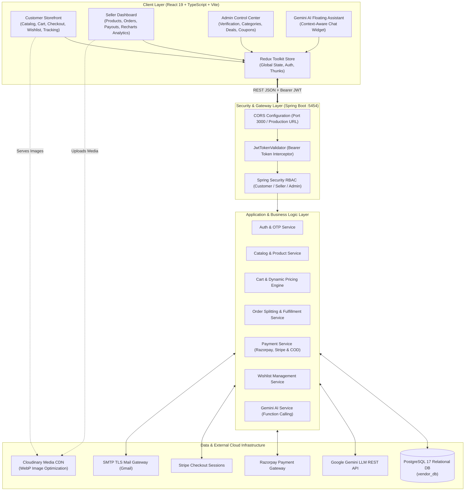
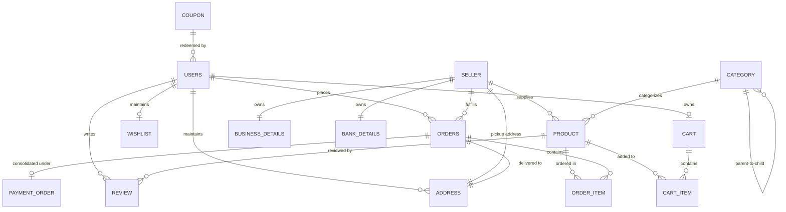

# Noir Bazar — Enterprise Multi-Vendor E-Commerce Platform with AI Conversational Commerce

[](https://www.oracle.com/java/)
[](https://spring.io/projects/spring-boot)
[](https://react.dev/)
[](https://www.typescriptlang.org/)
[](https://vitejs.dev/)
[](https://www.postgresql.org/)
[](https://ai.google.dev/)
[](https://razorpay.com/)
[](https://stripe.com/)

---

## 📌 Project Overview

**Noir Bazar** is an enterprise-grade digital marketplace and conversational commerce platform designed to bridge independent merchants (sellers) and buyers within a unified, high-performance ecosystem. Featuring a signature luxury dark-and-gold aesthetic, Noir Bazar pairs a robust **Spring Boot 3 (Java 21)** RESTful backend with a reactive **React 19, TypeScript, and Vite** Single Page Application (SPA).

The platform handles end-to-end e-commerce operations: multi-tier hierarchical catalog browsing, automated multi-vendor order decomposition, Cash on Delivery (COD), dual-gateway domestic/international digital payments (Razorpay & Stripe), live visual order tracking, an interactive wishlist engine, and an AI-powered conversational assistant driven by **Google Gemini LLM with Function Calling**.

---

## 📑 Table of Contents

- [Key Features](#-key-features)
- [System Architecture](#-system-architecture)
- [Functional Modules](#-functional-modules)
  - [1. Authentication & Security](#1-authentication--security)
  - [2. Multi-Vendor Order Decomposition](#2-multi-vendor-order-decomposition)
  - [3. Flipkart-Style Checkout & Cash on Delivery (COD)](#3-flipkart-style-checkout--cash-on-delivery-cod)
  - [4. Real-Time Order Tracking Visualizer](#4-real-time-order-tracking-visualizer)
  - [5. AI Conversational Assistant (Gemini Function Calling)](#5-ai-conversational-assistant-gemini-function-calling)
  - [6. Dynamic Wishlist Engine](#6-dynamic-wishlist-engine)
  - [7. Merchant Portal & Analytics](#7-merchant-portal--analytics)
  - [8. Admin Governance & Deals Management](#8-admin-governance--deals-management)
- [Technology Stack](#-technology-stack)
- [Database Schema (ER Diagram)](#-database-schema-er-diagram)
- [REST API Endpoints Specification](#-rest-api-endpoints-specification)
- [Cloud Deployment Strategy (100% Free Hosting)](#-cloud-deployment-strategy-100-free-hosting)
- [Local Setup & Getting Started](#-local-setup--getting-started)
- [Environment Configuration](#-environment-configuration)
- [Author & License](#-author--license)

---

## 🌟 Key Features

| Capability | Technical Highlight |
| :--- | :--- |
| **Multi-Vendor Order Splitting** | Automatically breaks a unified shopping cart into discrete sub-orders per vendor at checkout with atomic rollback safety. |
| **Flipkart-Style Multi-Step Checkout** | Clean progressive UX: Delivery Address Selection $\rightarrow$ Order Summary & Price Details $\rightarrow$ Flexible Payment Option Selection. |
| **Cash on Delivery (COD) Support** | Seamless offline payment mode generating orders with deferred settlement and immediate inventory reservation. |
| **Real-Time Visual Order Tracking** | 4-stage tracking timeline (`CONFIRMED` $\rightarrow$ `SHIPPED` $\rightarrow$ `OUT_FOR_DELIVERY` $\rightarrow$ `DELIVERED`) with status indicators and delivery ETAs. |
| **Google Gemini AI Assistant** | In-store conversational AI with registered function declarations (`getUserCart`, `getUsersOrder`, `getProductDetails`) for precision product search. |
| **Dynamic Wishlist System** | One-click heart toggling on product cards and details, live badge counter in navigation bar, and one-click move to cart. |
| **Dual Payment Gateways** | Native Indian UPI/Cards/Netbanking via **Razorpay** + Global multi-currency credit/debit card checkout via **Stripe**. |
| **Role-Based Access Control (RBAC)** | Strict isolation between `ROLE_CUSTOMER`, `ROLE_SELLER`, and `ROLE_ADMIN` using stateless JWT and Spring Security filters. |
| **Vendor Onboarding & Analytics** | Self-service merchant registration (GSTIN, bank details, pickup location) + interactive revenue and order charts via Recharts. |
| **Luxury Dark Theme UI** | Handcrafted Noir theme (`#C5A059` gold accents, `#121217` dark slate foundation) with glassmorphism and smooth responsive transitions. |

---

## 🏗️ System Architecture

Noir Bazar follows a **decoupled 3-tier client-server architecture**:



---

## 🧩 Functional Modules

### 1. Authentication & Security
- **Stateless JWT Tokens:** Cryptographically signed tokens utilizing `jjwt` with HMAC-SHA-256 algorithm.
- **Two-Factor OTP Verification:** Secure email OTP verification via Spring Mail (SMTP TLS) for customer login/signup, seller verification, and password resets.
- **BCrypt Password Hashing:** Salted irreversible password encryption with strict route guards separating merchant, customer, and admin domains.

### 2. Multi-Vendor Order Decomposition
- When a customer checks out a cart containing items from multiple distinct merchants:
  1. A master **PaymentOrder** is generated representing the consolidated monetary total.
  2. The service atomically groups items by `sellerId` and creates separate **Order** records per vendor.
  3. Each merchant fulfills their respective sub-order independently with individual tracking states:
     $$\text{PENDING} \longrightarrow \text{PLACED} \longrightarrow \text{CONFIRMED} \longrightarrow \text{SHIPPED} \longrightarrow \text{DELIVERED}$$

### 3. Flipkart-Style Checkout & Cash on Delivery (COD)
- **Step 1 — Address Management:** Select from saved delivery addresses or input a new one with PIN code validation.
- **Step 2 — Order Summary:** Detailed itemized list, discount breakdown, coupon savings, and delivery fee calculation.
- **Step 3 — Flexible Payment Selection:**
  - **Cash on Delivery (COD):** Direct order confirmation without online pre-payment. Order status initialized to `PENDING` with immediate stock deduction.
  - **Razorpay:** UPI, Net Banking, and domestic debit/credit cards with instant signature verification.
  - **Stripe:** Hosted secure checkout for international currencies and global cards.

### 4. Real-Time Order Tracking Visualizer
- Visual 4-step progress stepper displayed on user order detail pages:
  - 🔵 **Order Confirmed:** Payment settled or COD verified.
  - 🟣 **Shipped:** Vendor packaged goods and handed over to courier.
  - 🟡 **Out for Delivery:** Package reached the destination hub.
  - 🟢 **Delivered:** Order handed to customer with delivery confirmation timestamp.
- Displays tracking identifier, estimated arrival date, delivery address, and detailed price summary.

### 5. AI Conversational Assistant (Gemini Function Calling)
- Floating luxury chatbot powered by **Google Gemini API**.
- Equipped with real-time backend tool bindings (Function Calling):
  - `getUserCart`: Inspects items, quantities, and totals in the current shopper's cart.
  - `getUsersOrder`: Retrieves user order fulfillment history and live delivery tracking status.
  - `getProductDetails`: Looks up real-time inventory, pricing, fabric, and attributes for specific items.
- Enhanced with category-aware response styling and Markdown table/bullet presentation.

### 6. Dynamic Wishlist Engine
- Seamlessly save favorite items for later consideration.
- Connected across both product category grids and single-product view pages.
- Navigation bar displays real-time item count badge.
- Dedicated Wishlist page supporting instant transfer into the shopping cart.

### 7. Merchant Portal & Analytics
- Complete merchant lifecycle onboarding: business details, GSTIN, bank IFSC/account, and physical pickup address.
- Comprehensive inventory manager: add variants, colors, sizes, MRP, discounted selling price, and multi-image Cloudinary uploads.
- Visual revenue trends and fulfillment analytics powered by **Recharts**.

### 8. Admin Governance & Deals Management
- Vendor approval and account suspension workflows.
- 3-level taxonomy hierarchy management (e.g., `women` $\rightarrow$ `women_clothing` $\rightarrow$ `women_sarees`).
- Dynamic homepage deal grids, promotional carousels, and discount coupon creation (percentage/flat off with minimum purchase thresholds).

---

## 💻 Technology Stack

| Layer | Component | Version | Description |
| :--- | :--- | :--- | :--- |
| **Backend** | Spring Boot | 3.4.x | Core enterprise Java framework (REST, DI, Actuator) |
| **Language** | Java | 21 (LTS) | High-performance modern Java with Virtual Threads |
| **Persistence** | Spring Data JPA / Hibernate | 6.x | ORM mapping, repositories, JPQL criteria queries |
| **Database** | PostgreSQL | 17.x | ACID-compliant relational database |
| **Security** | Spring Security + JJWT | 0.11.5 | Stateless JWT authentication filter and RBAC |
| **Frontend** | React | 19.1.0 | Declarative component UI library |
| **Language** | TypeScript | 5.8.x | Static typing across models, state, and API contracts |
| **Build Tool** | Vite | 7.0.x | Ultra-fast build pipeline with instantaneous HMR |
| **State Management** | Redux Toolkit | 2.8.2 | Global store with asynchronous thunk dispatchers |
| **UI Components** | Material-UI (MUI) | 7.1.x | Enterprise design components, modals, and tables |
| **Styling** | Tailwind CSS | 3.4.x / 4.x | Utility-first CSS configured for Noir theme |
| **Icons** | Lucide React / MUI Icons | Latest | Crisp iconography for navigation and order states |
| **Charts** | Recharts | 2.15.x | Interactive SVG sales and order fulfillment charts |
| **Payments** | Razorpay SDK & Stripe SDK | Latest | Multi-gateway payment processing |
| **AI Engine** | Google Gemini API | v1beta | Generative conversational LLM with Function Calling |
| **CDN & Media** | Cloudinary API | v1_1 | Automatic responsive image optimization and WebP delivery |

---

## 🗄️ Database Schema (ER Diagram)



---

## 📡 REST API Endpoints Specification

### 🔐 Authentication & Profile (`/auth`, `/api/users`)
| Method | Endpoint | Access | Description |
| :--- | :--- | :--- | :--- |
| `POST` | `/auth/signup` | Public | Register new customer account |
| `POST` | `/auth/signin` | Public | Authenticate user & return JWT token |
| `POST` | `/auth/sent/login-signup-otp` | Public | Dispatch email OTP for login/signup |
| `GET` | `/api/users/profile` | Customer / Seller / Admin | Retrieve current authenticated user profile |

### 🛍️ Products & Categories (`/products`, `/categories`)
| Method | Endpoint | Access | Description |
| :--- | :--- | :--- | :--- |
| `GET` | `/products` | Public | Filtered and paginated product catalog |
| `GET` | `/products/{id}` | Public | Detailed product specification and media |
| `GET` | `/products/search` | Public | Full-text product search by keyword |
| `GET` | `/home-page` | Public | Homepage categories, promotional deals, and grids |

### 🛒 Cart & Wishlist (`/api/cart`, `/api/wishlist`)
| Method | Endpoint | Access | Description |
| :--- | :--- | :--- | :--- |
| `GET` | `/api/cart` | Customer | Fetch current customer shopping cart |
| `PUT` | `/api/cart/add` | Customer | Add product variant to cart |
| `PUT` | `/api/cart/item/{cartItemId}` | Customer | Update quantity of cart item |
| `DELETE` | `/api/cart/item/{cartItemId}` | Customer | Remove item from cart |
| `GET` | `/api/wishlist` | Customer | Fetch user saved wishlist items |
| `POST` | `/api/wishlist/add-product/{productId}` | Customer | Toggle product in/out of wishlist |

### 📦 Orders, Checkout & Tracking (`/api/orders`)
| Method | Endpoint | Access | Description |
| :--- | :--- | :--- | :--- |
| `POST` | `/api/orders` | Customer | Submit checkout: decomposes cart into vendor orders (supports COD and Online modes) |
| `GET` | `/api/orders/user` | Customer | Retrieve past and active order history |
| `GET` | `/api/orders/{orderId}` | Customer | Detailed order invoice, delivery address, and tracking status |
| `PUT` | `/api/orders/{orderId}/cancel` | Customer | Cancel an active placed order |

### 💳 Payments (`/api/payment`)
| Method | Endpoint | Access | Description |
| :--- | :--- | :--- | :--- |
| `POST` | `/api/payment/{paymentMethod}/order/{orderId}` | Customer | Initiate Razorpay / Stripe payment gateway session |
| `GET` | `/api/payment/{paymentMethod}` | Public / Webhook | Validate transaction signature and mark order paid |

### 🏬 Seller Operations (`/sellers`, `/api/sellers`, `/api/seller`)
| Method | Endpoint | Access | Description |
| :--- | :--- | :--- | :--- |
| `POST` | `/sellers` | Public | Register new vendor application |
| `GET` | `/api/sellers/products` | Seller | Fetch catalog items listed by this vendor |
| `POST` | `/api/sellers/products` | Seller | Create a new product listing |
| `DELETE` | `/api/sellers/products/{id}` | Seller | Delete an existing product listing |
| `GET` | `/api/seller/orders` | Seller | Retrieve orders assigned to this seller |
| `PATCH` | `/api/seller/orders/{orderId}/status/{status}` | Seller | Update fulfillment state (`CONFIRMED`, `SHIPPED`, `DELIVERED`) |
| `GET` | `/api/seller/reports` | Seller | Get seller earnings, unit sales, and revenue metrics |

### 🤖 AI Conversational Assistant (`/ai`)
| Method | Endpoint | Access | Description |
| :--- | :--- | :--- | :--- |
| `POST` | `/ai/chat` | Public / Customer | Send natural language shopping query to Gemini LLM |

---

## ☁️ Cloud Deployment Strategy (100% Free Hosting)

The platform is engineered to run seamlessly across reputable zero-cost cloud tiers:

```
┌────────────────────────────────────────────────────────┐
│                   DEPLOYMENT MAP                       │
├─────────────────────┬──────────────────┬───────────────┤
│ Frontend SPA        │ Vercel           │ 100% Free     │
│ Spring Boot Backend │ Render / Koyeb   │ 100% Free     │
│ Relational Database │ Neon PostgreSQL  │ 100% Free     │
│ Product Media CDN   │ Cloudinary       │ 100% Free     │
└─────────────────────┴──────────────────┴───────────────┘
```

1. **Database (Neon Serverless PostgreSQL):**
   - Create a free database instance on [Neon](https://neon.tech).
   - Copy the JDBC Connection URL with SSL enabled (`sslmode=require`).
2. **Backend (Render Web Service):**
   - Connect the GitHub repository `https://github.com/vineetsharma-stack/NoirBazar.git`.
   - Set Environment to `Docker` or `Java` (`mvn clean package -DskipTests`).
   - Populate environment variables (`SPRING_DATASOURCE_URL`, `JWT_SECRET`, `GEMINI_API_KEY`).
3. **Frontend (Vercel):**
   - Connect frontend repository to [Vercel](https://vercel.com).
   - Set Build Command: `npm run build` and Output Directory: `dist`.
   - Set Environment Variable: `VITE_API_BASE_URL=https://your-backend.onrender.com`.

---

## 🚀 Local Setup & Getting Started

### Prerequisites
- **Java:** JDK 21+ (`java -version`)
- **Maven:** Apache Maven 3.9+ (`mvn -version`)
- **Node.js:** Node.js v18+ and npm v9+ (`node -v`, `npm -v`)
- **Database:** PostgreSQL 15+ running on port `5432`

### Step 1: Clone the Repository
```bash
git clone https://github.com/vineetsharma-stack/NoirBazar.git
cd NoirBazar
```

### Step 2: Database Initialization
Open `psql` or pgAdmin and create the database:
```sql
CREATE DATABASE vendor_db;
```

### Step 3: Run the Spring Boot Backend
1. Open terminal in the backend directory:
   ```bash
   cd "Multi Vendor backend"
   ```
2. Verify credentials in `src/main/resources/application.properties`.
3. Launch the server:
   ```bash
   mvn clean spring-boot:run
   ```
   *Backend running at:* `http://localhost:5454`

### Step 4: Run the React Frontend
1. Open a new terminal in the frontend directory:
   ```bash
   cd ../frontend-vite
   ```
2. Install dependencies:
   ```bash
   npm install
   ```
3. Start the Vite development server:
   ```bash
   npm run dev
   ```
   *Frontend running at:* `http://localhost:3000`

---

## ⚙️ Environment Configuration

Sample configuration template for `application.properties`:

```properties
# Server Configuration
server.port=5454

# PostgreSQL Database Configuration
spring.datasource.url=jdbc:postgresql://localhost:5432/vendor_db
spring.datasource.username=postgres
spring.datasource.password=your_db_password
spring.jpa.hibernate.ddl-auto=update
spring.jpa.show-sql=false
spring.jpa.properties.hibernate.dialect=org.hibernate.dialect.PostgreSQLDialect

# JWT Security
jwt.secret=YourSuperSecretSecureJWTSigningKeyWithAtLeast256BitsLength1234567890
jwt.header=Authorization

# SMTP Email Configuration (Gmail App Password)
spring.mail.host=smtp.gmail.com
spring.mail.port=587
spring.mail.username=your_email@gmail.com
spring.mail.password=your_16_character_app_password
spring.mail.properties.mail.smtp.auth=true
spring.mail.properties.mail.smtp.starttls.enable=true

# Google Gemini AI API Key
gemini.api.key=YOUR_GEMINI_API_KEY

# Payment Gateways (Razorpay & Stripe)
razorpay.api.key=YOUR_RAZORPAY_KEY_ID
razorpay.api.secret=YOUR_RAZORPAY_KEY_SECRET
stripe.api.key=YOUR_STRIPE_SECRET_KEY
```

---

## 👨‍💻 Author & Repository

- **Developer:** [Vineet Sharma](https://github.com/vineetsharma-stack)
- **Repository:** [NoirBazar](https://github.com/vineetsharma-stack/NoirBazar.git)
- **Primary Domain:** Multi-Vendor E-Commerce & Conversational AI Marketplace
- **License:** Distributed under the MIT License. See `LICENSE` for more information.
